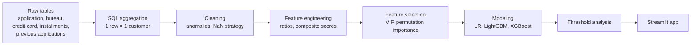

# 🏦 Home Credit Default Risk: End-to-End Credit Scoring


An end-to-end machine learning project that predicts whether a loan applicant will default, built on the Kaggle [Home Credit Default Risk](https://www.kaggle.com/competitions/home-credit-default-risk) dataset.

The project covers the full lifecycle: **SQL feature aggregation → data cleaning → feature engineering → statistically validated feature selection → model comparison and tuning → threshold analysis → a deployed Streamlit app.**

| Final model | Test ROC-AUC | Recall (threshold 0.5) | PR-AUC |
|---|---|---|---|
| XGBoost | **0.774** | 69% | 0.27 (baseline is the 8% default rate) |

---

## 📌 Why this project is worth a look

Most tutorials stop at `model.fit()`. This project focuses on the decisions around the model, and documents *why* each was made:

- **Leakage-aware by design.** SQL joins only use records dated before the application, and imputation values, clip thresholds and VIF decisions are computed on the training portion only.
- **Every engineered feature was tested.** Features were validated with Mann-Whitney U tests and correlation checks. Weak ones were documented instead of silently kept.
- **Self-corrected bugs.** For example, a ratio feature that was inflated about 12x by a unit mix-up was caught by a sanity check and fixed.
- **Model-appropriate preprocessing.** VIF pruning was used for the linear model, and permutation importance for tree models.
- **Honest evaluation.** The project reports precision, recall, PR-AUC and the confusion matrix next to ROC-AUC, and discusses limitations.

---

## 🗺️ Pipeline overview



---

## 🗄️ 1. SQL feature aggregation (PostgreSQL)

The raw data is spread across tables at different granularities (applications, monthly balances, installments). A single SQL script built from CTEs turns them into **one row per customer** keyed on `SK_ID_CURR`.

| Source table | Example features |
|---|---|
| `credit_card_balance` | card count, credit limit, ATM drawings, DPD frequency |
| `bureau` + `bureau_balance` | active and closed credits, total debt, overdue frequency, worst status |
| `installments_payments` | payment ratio, late days, late-payment frequency, payment gap |
| `previous_application` | approval and refusal rates, approved credit and annuity statistics |

Design choices:

- **Two-stage aggregation** (card level, then customer level) avoids averaging averages or summing ratios.
- `FILTER (WHERE ...)` for conditional counts and `NULLIF` against division by zero.
- **Leakage guards in SQL:** `MONTHS_BALANCE <= 0`, `DAYS_CREDIT < 0`, `DAYS_INSTALMENT < 0`, `DAYS_DECISION < 0`.
- `LEFT JOIN` onto the application table keeps every customer.

---

## 🧹 2. Data cleaning

| Column | Problem | Fix |
|---|---|---|
| `days_employed` | Placeholder `365243` (about 1,000 years) in 55,374 rows, used for pensioners and unemployed | Binary flag, replace with NaN, impute with median |
| `amt_income_total` | Max of 117 million, skew 1.35 | Clip at the 99th percentile (472,500), then `log1p` (skew −0.02) |
| `amt_req_credit_bureau_qrt` | Max of 261 inquiries per quarter | Clip at the 99.9th percentile (4) |
| `payment_ratio` | Max of 5.49 | Clip at the 99th percentile (1.57) |
| `own_car_age` | About 66% missing, weak signal | Dropped |

**Missing-value strategy.** In history tables, NaN means *"no history"*, not *"bad data"*. Count and history columns are filled with `0`. Score-like columns (`ext_source_*`) are filled with the median, and indicator columns (`has_ext_source_1`, `has_ext_source_3`, `has_bureau_balance_history`) are created **before** imputation so the "was missing" signal survives.

---

## 🧪 3. Feature engineering

| Feature | Idea |
|---|---|
| `ext_source_mean / std / max / min` | Combine the three external credit scores and measure their disagreement |
| `credit_health_score` | Weighted score from closed-credit rate, delinquency, late payments and approval rate |
| `confidence_adjusted_health` | `credit_health_score` × (1 − `ext_source_std`), a score adjusted for uncertainty |
| `annual_debt_ratio` | Annuity divided by annual income |
| `credit_relative_to_income_peers` | Credit amount as a z-score within income deciles |
| `housing_quality_score` | Mean of the normalized building-quality columns |
| `closed_credit_rate` | Share of bureau credits that are closed |
| `financial_activity_density` | Financial products held per year of age |
| `income_per_family_member`, `children_ratio`, `address_instability_score`, `document_count`, `contact_completeness` | Household and stability signals |

### Statistical validation

Each candidate was tested with a **Mann-Whitney U test**, which is robust to the ~92/8 class imbalance, and with its correlation to the target. A few examples:

- `credit_health_score`: median **0.791** (non-default) vs **0.724** (default), p ≈ 0. It is a real, usable signal.
- `annual_debt_ratio`: **0.162** vs **0.169**. It is statistically significant but practically small, which is common in a dataset with 300K+ rows.
- `disposable_income_ratio`: no meaningful separation. It was documented as a weak feature, not forced into the model.

---

## 🎯 4. Feature selection

| Method | Used for | Why |
|---|---|---|
| **VIF** (iterative removal) | Logistic Regression | Multicollinearity destabilizes linear coefficients. Features such as `ext_source_mean` and `stability_score` are exact linear combinations of their components and reached a VIF of about 10¹⁵ |
| **Correlation pruning** (|r| above 0.85) | Linear models | From each correlated pair, the feature weaker against the target was dropped |
| **Permutation importance** | Tree models | Trees tolerate collinearity, so selection is driven by actual predictive contribution |

Result: 17 features had zero permutation importance. Removing them gave CV ROC-AUC 0.7694 vs 0.7720 with all features. That gap is at noise level, which shows trees handle redundant features well.

---

## 🤖 5. Modeling

All models use the same stratified split (94% development, 6% untouched hold-out) and **encoding inside sklearn pipelines**, so no preprocessing statistics leak across folds.

| Model | Search | CV ROC-AUC | Test ROC-AUC |
|---|---|---|---|
| Logistic Regression | GridSearchCV, 5-fold | 0.764 | 0.762 |
| LightGBM | RandomizedSearchCV, 3-fold, `scale_pos_weight` | 0.773 | 0.773 |
| **XGBoost** | RandomizedSearchCV, 3-fold, `tree_method='hist'` | **0.775** | **0.774** |

Final XGBoost parameters: `max_depth=3`, `learning_rate≈0.084`, `n_estimators=526`, `subsample≈0.79`, `colsample_bytree≈0.86`, `min_child_weight=9`.

### How much did feature engineering add?

An XGBoost/LightGBM model on the three raw `EXT_SOURCE` columns alone reaches **0.721 ROC-AUC**. The engineered feature set lifts that to **0.774**, a gain of roughly **+0.05** from the work in steps 1 to 4.

### Why LightGBM and Logistic Regression ended up close

The engineered ratios and scores already encode much of the non-linearity by hand, so linear models can use them directly, and trees gain less. Keeping raw component columns for the tree models gave a small additional lift.

---

## 📊 6. Results and threshold analysis

At the default threshold of 0.5 (test set: 18,451 customers, 1,490 defaulters):

| | Predicted: no default | Predicted: default |
|---|---|---|
| **Actual: no default** | 12,241 | 4,720 |
| **Actual: default** | 462 | 1,028 |

- **Recall 69%**: 1,028 of 1,490 defaulters are caught.
- **Precision 18%**: many false alarms, which is expected at 8% prevalence.
- **PR-AUC 0.27**: more than 3x the 8% baseline.

The threshold is a **business decision**, not a modeling one. Optimizing F1 on a validation split moves the operating point to a higher threshold (about 0.70) with higher precision (about 27%) and lower recall (about 38%). In credit risk, a missed defaulter usually costs more than a rejected good customer, so a recall-oriented threshold is often preferable.

### Top drivers (XGBoost gain)

`avg_atm_drawings`, `credit_health_score` (engineered), `ext_source_3`, `has_ext_source_1` (engineered), `avg_drawings`, `code_gender_F`. SHAP was used to examine the direction of effects.

---

## 🖥️ 7. Streamlit app

An interactive app serves the trained pipeline:

- Select a customer from a 300-row sample that was held out from training.
- See the predicted default probability, a gauge visualization and a risk band (**below 20% low, 20–50% medium, above 50% high**).
- Batch view with the risk distribution and the 10 highest-risk customers.

```bash
streamlit run app.py
```

---

## 🚀 Reproduce it

```bash
# 1. Get the data from Kaggle and load the CSVs into PostgreSQL
# 2. Run the SQL feature script to build the customer-level table
# 3. Install dependencies
pip install pandas numpy scikit-learn xgboost lightgbm statsmodels scipy \
            seaborn matplotlib streamlit plotly joblib

# 4. Run the notebooks in order: preprocessing → feature engineering → modeling
# 5. Launch the app (needs final_model.pkl and deployment_sample.csv)
streamlit run app.py
```

---

## ⚠️ Limitations and next steps

**Known limitations**

- Some median and clip statistics were computed before the train/hold-out split. The effect is small on 300K+ rows, and the cleaner fix is to move all of them into sklearn pipelines.
- Precision is low at the default threshold. The threshold should be chosen against real misclassification costs.
- `POS_CASH_balance` is not used yet.

**Next steps**

- Time-windowed features (last 3, 6 and 12 months) and trend features from balance tables.
- Add `POS_CASH_balance` aggregation.
- Cost-based threshold selection and probability calibration.
- Ensembling XGBoost, LightGBM and CatBoost.

---

## 👤 Author

**[Your Name]**: [LinkedIn](https://www.linkedin.com/) · [Email](mailto:you@example.com)

*Built as part of a Data Science course; the dataset belongs to Home Credit and is available on Kaggle.*
