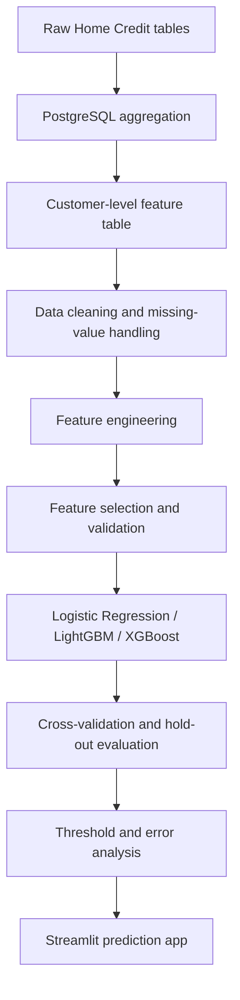

# Home Credit Default Risk — End-to-End Credit Scoring

<p align="center">
  <strong>Customer-level credit-risk modeling with PostgreSQL, Python, XGBoost, LightGBM, and Streamlit</strong>
</p>

<p align="center">
  
  
  
  
</p>

An end-to-end machine-learning project that estimates the probability of loan default using the Kaggle **Home Credit Default Risk** dataset. The project combines customer-level SQL feature aggregation, feature engineering, model comparison, threshold analysis, and an interactive Streamlit application.

> **Best recorded hold-out result:** XGBoost ROC-AUC **0.774**. At a 0.5 classification threshold, recall is **69%** and precision is **18%**. These metrics describe ranking and one particular operating threshold; they do not, by themselves, establish business profitability or production readiness.

---

## Table of Contents

- [Project Overview](#project-overview)
- [Key Results](#key-results)
- [Workflow](#workflow)
- [1. SQL Feature Aggregation](#1-sql-feature-aggregation)
- [2. Data Cleaning and Missing Values](#2-data-cleaning-and-missing-values)
- [3. Feature Engineering](#3-feature-engineering)
- [4. Feature Selection](#4-feature-selection)
- [5. Model Development](#5-model-development)
- [6. Evaluation and Threshold Analysis](#6-evaluation-and-threshold-analysis)
- [7. Feature Importance and Interpretation](#7-feature-importance-and-interpretation)
- [8. Streamlit Application](#8-streamlit-application)
- [Reproducibility](#reproducibility)
- [Limitations and Next Steps](#limitations-and-next-steps)
- [Author](#author)

## Project Overview

Credit-risk modeling is a binary-classification problem: estimate which loan applicants are more likely to default. The dataset is imbalanced, with a default rate of approximately **8%**, so ROC-AUC alone is not enough to describe model performance.

This project focuses not only on fitting models, but also on the decisions surrounding them:

- Aggregating historical financial records into one row per applicant.
- Engineering customer-level financial and behavioral features.
- Comparing a linear baseline with gradient-boosted tree models.
- Using validation-based model selection and examining classification thresholds.
- Reviewing feature importance and model limitations.
- Serving predictions through a Streamlit interface.

### Project at a glance

| Item | Description |
|---|---|
| Problem | Binary classification: loan default risk |
| Dataset | [Kaggle — Home Credit Default Risk](https://www.kaggle.com/competitions/home-credit-default-risk) |
| SQL | PostgreSQL; CTE-based feature aggregation |
| Modeling | Logistic Regression, LightGBM, XGBoost |
| Main metric | ROC-AUC, supplemented by PR-AUC, precision, recall, and confusion matrix |
| Application | Streamlit |
| Prediction unit | One applicant (`SK_ID_CURR`) per row |

## Key Results

### Hold-out model comparison

| Model | Search strategy | CV ROC-AUC | Hold-out ROC-AUC |
|---|---|---:|---:|
| Logistic Regression | GridSearchCV, 5-fold CV | 0.764 | 0.762 |
| LightGBM | RandomizedSearchCV, 3-fold CV | 0.773 | 0.773 |
| **XGBoost** | RandomizedSearchCV, 3-fold CV | **0.775** | **0.774** |

The best recorded XGBoost hold-out ROC-AUC is **0.774**. The close cross-validation and hold-out scores are consistent with similar ranking performance on these splits, although a single hold-out set cannot guarantee performance on future applicants.

### XGBoost at the default threshold

| Metric | Result |
|---|---:|
| Hold-out applicants | 18,451 |
| Actual defaulters | 1,490 |
| ROC-AUC | 0.774 |
| PR-AUC | 0.27 |
| Recall | 69% |
| Precision | 18% |

The approximate PR-AUC baseline is the positive-class prevalence (about 8%). PR-AUC of 0.27 is higher than that baseline, but precision remains low at the default threshold. The threshold should therefore be selected according to the bank's tolerance for missed defaulters, false alarms, and review capacity—not solely by a generic metric.

## Workflow



## 1. SQL Feature Aggregation

The source data is stored across tables with different levels of detail, including applications, bureau records, monthly credit-card balances, installment payments, and previous applications. PostgreSQL CTEs aggregate these histories and join the resulting features to the application table using `SK_ID_CURR`.

The target structure is **one row per applicant**.

| Source table | Example customer-level features |
|---|---|
| `credit_card_balance` | Card count, credit limit, ATM drawings, delinquency frequency |
| `bureau` and `bureau_balance` | Active/closed credit counts, total debt, overdue frequency, worst status |
| `installments_payments` | Payment ratio, late days, late-payment frequency, payment gap |
| `previous_application` | Approval/refusal rates and approved-credit/annuity statistics |

### SQL design choices

- **Two-stage aggregation:** aggregate monthly observations to the card/credit level before aggregating to the customer level.
- **Conditional aggregation:** use `FILTER (WHERE ...)` where appropriate.
- **Safe ratios:** use `NULLIF` to guard against division by zero.
- **Customer retention:** use `LEFT JOIN` from the application table so applicants without a particular history table are not discarded.
- **Temporal filtering:** apply the project’s date/relative-time filters so only records available before the current application contribute to historical features.

## 2. Data Cleaning and Missing Values

| Column | Issue | Treatment |
|---|---|---|
| `days_employed` | Placeholder value `365243`, found in 55,374 rows | Create an anomaly indicator, replace the placeholder with missing, then impute |
| `amt_income_total` | Strongly right-skewed; maximum around 117 million | Clip at the recorded 99th percentile (472,500), then apply `log1p` |
| `amt_req_credit_bureau_qrt` | Extreme maximum of 261 inquiries per quarter | Clip at the recorded 99.9th percentile (4) |
| `payment_ratio` | Maximum around 5.49 | Clip at the recorded 99th percentile (1.57) |
| `own_car_age` | Approximately 66% missing and weak signal | Dropped during feature preparation |

### Missingness carries information

For historical tables, missing values may mean that no history is available, rather than that a value was simply not recorded. The project therefore distinguishes between:

- History/count features, where absence may be represented as zero when that interpretation is valid.
- Score-like features such as `ext_source_*`, which are imputed using a training-derived median.
- Missingness indicators such as `has_ext_source_1`, `has_ext_source_3`, and `has_bureau_balance_history`, created to preserve the fact that information was absent.

**Leakage note:** the current experiment notes that some clipping and median statistics were computed before the train/hold-out split. Those results should be treated as provisional until these statistics are fitted using only training data (ideally inside the cross-validation pipeline) and the model is re-evaluated on an untouched hold-out set.

## 3. Feature Engineering

The project creates financial, repayment, credit-history, and household-stability features to summarize applicant behavior.

| Feature | Rationale |
|---|---|
| `ext_source_mean`, `ext_source_std`, `ext_source_max`, `ext_source_min` | Summarize external credit scores and their variation |
| `credit_health_score` | Composite score using closed-credit rate, delinquency, late payments, and approval rate |
| `confidence_adjusted_health` | `credit_health_score × (1 − ext_source_std)` |
| `annual_debt_ratio` | Annuity relative to annual income |
| `credit_relative_to_income_peers` | Credit amount expressed as a z-score within income deciles |
| `housing_quality_score` | Summary of normalized building-quality features |
| `closed_credit_rate` | Share of bureau credits that are closed |
| `financial_activity_density` | Financial products relative to age |
| Household/stability features | `income_per_family_member`, `children_ratio`, `address_instability_score`, `document_count`, `contact_completeness` |

### Statistical checks

Candidate features were examined using Mann–Whitney U tests and target-correlation checks. Statistical significance was interpreted alongside the size of the observed difference, because a dataset with more than 300,000 rows can make small effects statistically significant.

Examples recorded during the analysis:

- `credit_health_score`: median 0.791 for non-defaulters versus 0.724 for defaulters.
- `annual_debt_ratio`: 0.162 versus 0.169; statistically significant in the analysis, but with a small difference.
- `disposable_income_ratio`: no meaningful separation in the observed comparison, so it was treated as a weak candidate.

These checks help describe feature behavior; they do not independently prove that a feature improves out-of-sample model performance.

## 4. Feature Selection

Different methods were used for different model families.

| Method | Applied to | Purpose |
|---|---|---|
| Iterative VIF analysis | Logistic Regression | Identify multicollinearity that can make linear coefficients unstable |
| Correlation pruning (`|r| > 0.85`) | Linear models | Reduce redundant highly correlated features |
| Permutation importance | Tree models | Assess the effect of feature shuffling on predictive performance |

Some engineered features are combinations of other features, so very large VIF values can indicate exact or near-exact linear dependence. VIF was treated as a linear-model diagnostic rather than a universal feature-selection rule.

In the recorded tree-model experiment, 17 features had zero permutation importance. Removing them resulted in CV ROC-AUC of **0.7694**, compared with **0.7720** when all features were retained. Based on those results, the reduced feature set was not adopted as the better-performing option.

## 5. Model Development

The project compares three approaches:

- **Logistic Regression:** an interpretable linear baseline.
- **LightGBM:** gradient-boosted decision trees.
- **XGBoost:** gradient-boosted decision trees, tuned using randomized search.

The recorded modeling setup uses a stratified 94% development / 6% hold-out split. Hyperparameters are selected on the development portion using cross-validation; the hold-out set is intended for final evaluation.

### Recorded XGBoost configuration

The best recorded parameters were approximately:

| Parameter | Value |
|---|---:|
| `max_depth` | 3 |
| `learning_rate` | 0.084 |
| `n_estimators` | 526 |
| `subsample` | 0.79 |
| `colsample_bytree` | 0.86 |
| `min_child_weight` | 9 |
| `tree_method` | `hist` |

The model also used `scale_pos_weight` to account for class imbalance. Exact parameters and metrics should be regenerated from the saved experiment if the training setup changes.

### Feature engineering contribution

A model using only the three raw `EXT_SOURCE` features achieved a recorded ROC-AUC of **0.721**, while the engineered feature set achieved **0.774** in the reported experiment. This comparison suggests that the added features contain useful signal; the comparison should use identical data splits and evaluation procedures to attribute the difference confidently to feature engineering.

## 6. Evaluation and Threshold Analysis

ROC-AUC measures how well the model ranks positive cases above negative cases across thresholds. Because the default class is relatively rare, the project also reports PR-AUC, precision, recall, and the confusion matrix.

At threshold **0.5**, the recorded hold-out confusion matrix is:

|  | Predicted: no default | Predicted: default |
|---|---:|---:|
| **Actual: no default** | 12,241 | 4,720 |
| **Actual: default** | 462 | 1,028 |

Interpretation:

- **Recall ≈ 69%:** the model identifies 1,028 of the 1,490 actual defaulters.
- **Precision ≈ 18%:** among applicants flagged as defaulters, a relatively small share actually default.
- **PR-AUC = 0.27:** higher than the approximate 8% positive-class baseline.

### Choosing a threshold

A threshold is an operational decision, not just a modeling parameter. A lower threshold generally catches more potential defaulters but also flags more non-defaulters. A higher threshold usually reduces false alarms while missing more actual defaulters.

The experiment recorded that F1-based threshold selection moved the threshold to around 0.70, with precision around 27% and recall around 38%. This is a different trade-off from the default 0.5 threshold. The threshold should be selected on validation data—not on the final hold-out set—and should ultimately reflect misclassification costs and the bank’s review capacity.

## 7. Feature Importance and Interpretation

The recorded XGBoost gain analysis highlighted features including:

- `avg_atm_drawings`
- `credit_health_score`
- `ext_source_3`
- `has_ext_source_1`
- `avg_drawings`
- `code_gender_F`

SHAP was also used to examine the direction of feature effects. Feature importance and SHAP answer different questions: gain summarizes a feature’s contribution to tree splits, while SHAP helps explain how feature values contribute to individual predictions and overall model behavior. Neither should be interpreted as proof of causation.

## 8. Streamlit Application

The Streamlit app provides an interactive interface for the trained model.

Recorded functionality includes:

- Select an applicant from a 300-row deployment sample held out from training.
- View the predicted default probability.
- View a gauge and risk band: below 20% = low, 20–50% = medium, above 50% = high.
- Explore a batch view with risk distribution and the 10 highest-risk applicants.

Run the application from the project directory:

```bash
streamlit run app.py
```

The app expects `final_model.pkl` and `deployment_sample.csv` to be available in the project directory. The risk bands are presentation categories for this application; they should not be treated as validated lending policy cutoffs.

## Reproducibility

### Requirements

The project uses Python and the following libraries:

```bash
pip install pandas numpy scikit-learn xgboost lightgbm statsmodels scipy \
            seaborn matplotlib streamlit plotly joblib
```

PostgreSQL is required for the SQL feature-aggregation stage. Download the source dataset from the [Kaggle competition page](https://www.kaggle.com/competitions/home-credit-default-risk) and load the required CSV files into your database.

### Run order

1. Download the dataset from Kaggle.
2. Load the source CSV files into PostgreSQL.
3. Run the SQL aggregation script to create the customer-level feature table.
4. Run the notebooks in order: preprocessing, feature engineering, and modeling.
5. Ensure `final_model.pkl` and `deployment_sample.csv` are in the app directory.
6. Launch Streamlit:

   ```bash
   streamlit run app.py
   ```

> Reproducibility note: exact results may vary with data preparation, split definitions, package versions, and random seeds. The metrics above are the results recorded for the current experiment, not a guarantee that every fresh run will reproduce them exactly.

## Limitations and Next Steps

### Known limitations

- Some clipping and imputation statistics were computed before the train/hold-out split. Move these steps into training-fitted preprocessing and rerun evaluation before treating the hold-out result as a fully leakage-controlled estimate.
- Precision is low at the default threshold; threshold selection needs a business cost framework.
- `POS_CASH_balance` is not yet included.
- The reported performance is offline evaluation on one hold-out split, not evidence of live production performance.
- Probability calibration has not yet been reported as completed.

### Planned improvements

- Add `POS_CASH_balance` aggregations.
- Build time-windowed and trend features from historical balance tables.
- Move all learned preprocessing statistics into cross-validation-safe pipelines.
- Compare thresholds using expected cost, recall constraints, and operational review capacity.
- Evaluate probability calibration.
- Explore ensembling XGBoost, LightGBM, and CatBoost.

## Author

**[Your Name]**  
[LinkedIn](https://www.linkedin.com/) · [Email](mailto:you@example.com)

*Built as a Data Science portfolio project. The dataset is provided by Home Credit and distributed through the Kaggle competition.*
